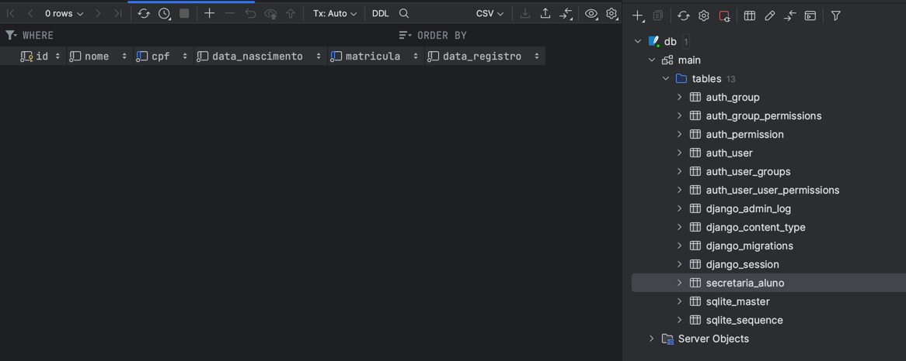

# Projeto com exemplos de Teste variados

## Aplicações no pacote `apps` para teste unitário

## Testes no pacote `test_apps`

### Executando teste com unittest apenas

`python -m unittest`

### Executando testes com coverage

#### Criar um ambiente virtual
`python3 -m venv venv`

#### Instalar a biblioteca coverage
`pip install coverage`

#### Alterar o executor do unittest para coverage 
#### (na raiz do projeto por padrão utilizar test_*.py na frente dos módulos de teste)
`python -m unittest discover`

#### Executar o teste com o coverage
`coverage run -m unittest discover` 

### Rodar cobertura de teste em app (runtime)
`python -m coverage run apps/main.py`

#### Gerar report no terminal
`coverage report -m`

#### Gerar report HTML
`coverage html`

## Aplicações no pacote educacional para teste de integração

### Instale o Django e o Django REST Framework:

pip install django djangorestframework

### Criado o projeto educacional:

django-admin startproject educacional

### Criado o projeto educacional:

- Acessar a pasta do projeto e criar o app:

python manage.py startapp secretaria

### Incluído o app no settings do projeto e o rest_framework

    'rest_framework',  
    'secretaria',           

### Migrar as tabelas padrões do Django

python manage.py migrate

### Criado models.py e serializers.py para a entidade Aluno

### Criado a migração para a entidade aluno

python manage.py makemigrations
python manage.py migrate

### Criar testes 

pip install pytest

### Instalar ferramenta teste funcional automatizado

pip install pytest-playwright
playwright install chromium

## Aplicações no pacote educacional para teste de sistema

### Abrir o gerador de cógido do Playwright
playwright codegen 127.0.0.1:8000/admin